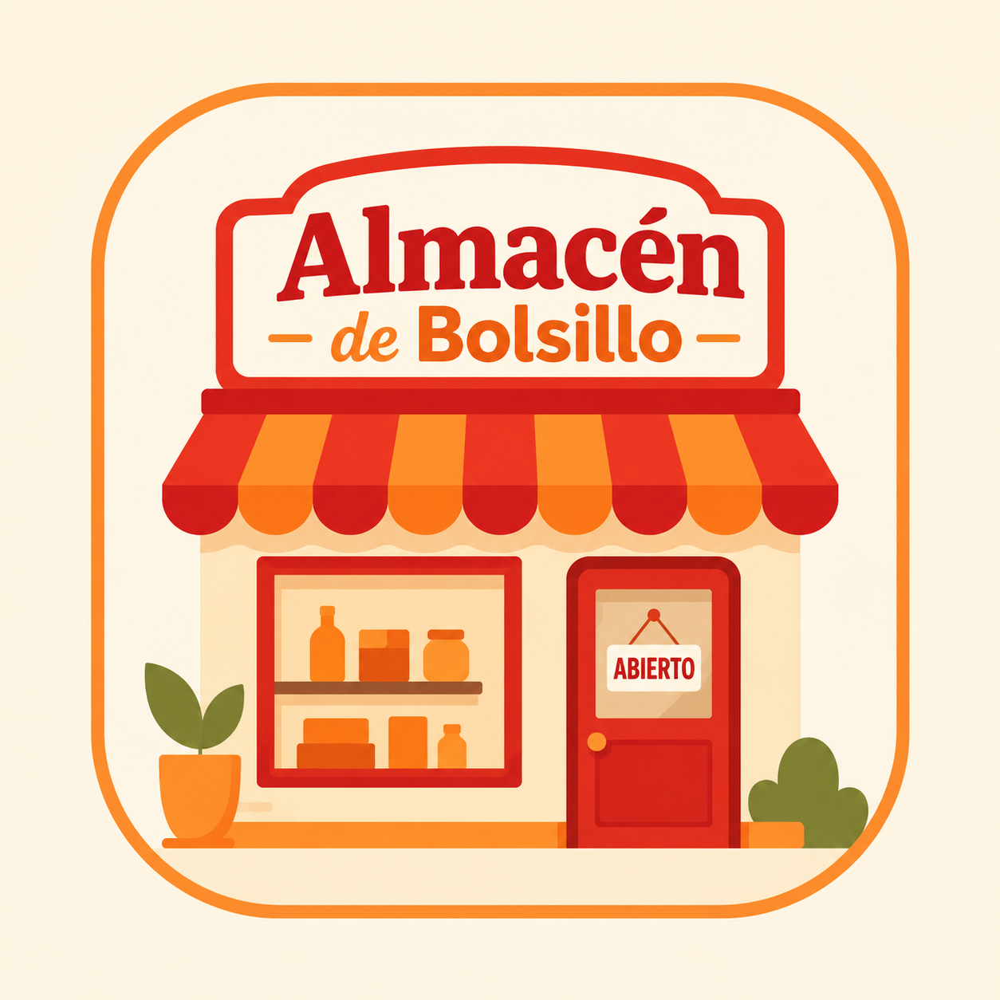

<div align="center">
  

  # Almacén de Bolsillo

  **Una aplicación para organizar y gestionar pequeños comercios desde el celular.**

  **Status: V.1.00 ready**
</div>

## Acerca del proyecto

Almacén de Bolsillo es el proyecto final de la Tecnicatura Universitaria en Programación de la Universidad Tecnológica Nacional (2025). La aplicación ayuda a los pequeños comercios a mantener organizada la gestión cotidiana de su negocio.

El repositorio está organizado como un workspace con una aplicación móvil desarrollada con Expo y React Native, una API construida con Node.js y Express, y un paquete compartido con contratos TypeScript.

## Estructura

```text
almacen-de-bolsillo/
├── backend/          # API REST, Prisma y PostgreSQL
├── frontend/         # Aplicación Expo y React Native
└── packages/shared/  # Tipos y contratos compartidos
```

## Requisitos

- Node.js
- pnpm 11.9.0
- PostgreSQL
- [Expo Go](https://expo.dev/go) para ejecutar la aplicación en un dispositivo móvil

## Instalación y ejecución

Desde la raíz del repositorio:

```bash
cd almacen-de-bolsillo
pnpm install
pnpm dev
```

El comando `pnpm dev` inicia el paquete compartido, el backend y el frontend en paralelo.

También es posible iniciar cada aplicación por separado:

```bash
pnpm dev:backend
pnpm dev:frontend
```

Una vez iniciado el frontend, escaneá el código QR con Expo Go para abrir la aplicación en tu dispositivo.

## Tecnologías principales

- **Frontend:** Expo, React Native, Expo Router y NativeWind
- **Backend:** Node.js, Express, TypeScript y Prisma ORM
- **Base de datos:** PostgreSQL
- **Autenticación y permisos:** credenciales con hash `scrypt` y RBAC
- **Gestión del workspace:** pnpm
- **Herramientas:** TypeScript, Prisma, pnpm y EAS

Consultá el [detalle completo del stack](./docs/Stack.md).

## Documentación

- [Guía de pantallas y funcionalidades](./docs/GuiaDePantallas.md)
- [Requisitos funcionales](./docs/almacen_bolsillo_rfs_extendido_mvp.md)
- [Requisitos funcionales innovadores](./docs/almacen_de_bolsillo_rfs_innovadores.md)
- [Matriz de roles y permisos](./docs/matriz_permisos_uml_almacen_bolsillo_md_2026.md)
- [Convenciones de nombres](./docs/NamingConventions.md)
- [Diseño entidad-relación](./docs/DER%20v1.drawio.png)
- [Diseño entidad-relación — modo oscuro](./docs/DER%20v1_oscuro.drawio.png)

## Autores

- [Mariano Belgrano](mailto:mbelgrano@gmail.com)
- [Lautaro Flor Kovinchich](mailto:lautaroflor.k@gmail.com)
